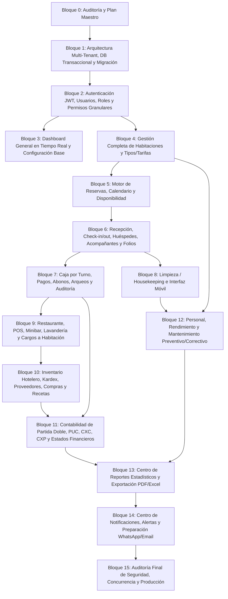

# AUDITORÍA Y PLAN DE TRANSFORMACIÓN HOTELERA (PMS PROFESIONAL MULTI-TENANT)

**Fecha de Auditoría:** 10 de noviembre de 2026  
**Proyecto Base:** Sistema Administrativo Familiar (`Sistema-mam-`)  
**Objetivo:** Transformación integral a un **Sistema PMS (Property Management System) Hotelero Profesional SaaS Multiempresa** bajo el principio:  
> **"UN SOLO SISTEMA. TODAS LAS FUNCIONALIDADES. UNA SOLA SUSCRIPCIÓN."**

---

## 1. ESTADO ACTUAL DEL PROYECTO

El repositorio presenta **dos estados superpuestos** que es fundamental distinguir antes de tocar cualquier línea de código:

### 1.1 Estado en Git `HEAD` (Commit `75ea4383`) — Sistema Administrativo Familiar Original
En el último commit confirmado en Git, el sistema operaba como una aplicación multi-negocio familiar con:
- **Hotel 1 y Hotel 2:** Control independiente con tablas separadas (`hotel1_rooms`, `hotel1_guests`, `hotel1_transactions` y sus equivalentes `hotel2_*`), lógica de cálculo de mora/periodos vencidos (`Pago diario`, `Pago cada 3 días`, `Pago semanal`), abonos parciales, pago completo en 1 clic y edición de habitación/huésped.
- **Restaurante:** Punto de venta rápido (`restaurant_sales`, `restaurant_expenses`) con selector rápido de platos (Almuerzo, Desayuno, Sopa, Caldo), métodos de pago (Efectivo/Transferencia) y generación de reporte diario en PDF (`jsPDF` + `jspdf-autotable`).
- **Lichiguería (Venta de legumbres):** Gestión de proveedores (`lichigueria_providers`), ventas por peso/unidad (`lichigueria_sales`), gastos (`lichigueria_expenses`) y reporte PDF diario.
- **Base de datos en `HEAD` (`backend/sistema_familiar.db`):** Contiene datos reales registrados:
  - `users`: 1 usuario (`admin`)
  - `hotel1_rooms`: 4 habitaciones configuradas
  - `hotel1_guests`: 4 huéspedes activos con historial de fechas y saldos
  - `hotel1_transactions`: 22 movimientos financieros reales
  - `restaurant_sales`: 4 ventas | `restaurant_expenses`: 1 gasto
  - `lichigueria_sales`: 2 ventas | `lichigueria_expenses`: 2 gastos

### 1.2 Estado en el Working Tree Actual (Cambios locales sin confirmar en Git)
En el directorio de trabajo actual existe un intento previo e incompleto de migración a PMS que dejó el proyecto en un **estado intermedio roto**:
1. **Archivos eliminados sin migrar su lógica (`git status`):**
   - Backend: `hotel1.js`, `hotel2.js`, `restaurante.js`, `lichigueria.js`, `reports.js` (tanto en `src/controllers/` como en `src/routes/`).
   - Frontend: `Hotel1.tsx`, `Hotel2.tsx`, `Restaurante.tsx`, `Lichigueria.tsx`.
2. **Archivos nuevos o modificados parcialmente:**
   - [init.js](file:///e:/Repositorios/Sistema-mam-/backend/src/db/init.js): Define 13 tablas iniciales de un esquema PMS (`users`, `hotels`, `room_types`, `rooms`, `guests`, `reservations`, `reservation_rooms`, `stays`, `guest_accounts`, `account_charges`, `payments`, `cash_registers`, `cash_movements`, `inventory_products`, `audit_logs`), pero **carece de soporte completo multi-tenant (`hotel_id`) en tablas críticas**, no incluye migración de datos previos y aún le faltan las tablas de Limpieza/Housekeeping, Mantenimiento, Restaurante/Servicios POS, Kardex/Proveedores/Compras/Recetas, Contabilidad de Partida Doble (PUC, asientos, CXC, CXP) y Notificaciones.
   - [hotelController.js](file:///e:/Repositorios/Sistema-mam-/backend/src/controllers/hotelController.js): Solo implementa parcialmente `getDashboard`, `getRooms`, `createRoom`, `updateRoom`, `deleteRoom` y `getTransactions`. Los métodos `assignGuest`, `registerPayment`, `checkoutRoom`, `createTransaction` y `deleteTransaction` devuelven **`501 Not implemented in Bloque 1`**.
   - [Hotel.tsx](file:///e:/Repositorios/Sistema-mam-/frontend/src/pages/Hotel.tsx): Unifica visualmente Hotel 1 y Hotel 2, pero invoca endpoints inexistentes o con rutas distintas (`/rooms/:id/guest` vs `/rooms/:id/assign`, `/rooms/:id/payment` vs `/rooms/:id/pay`) y compara estados incompatibles (`room.status === 'Libre'` en línea 1120 mientras el backend devuelve `'DISPONIBLE'`).
   - `backend/sistema_familiar.db`: Fue recreado por `seed.js` con 5 habitaciones vacías, aunque **toda la base de datos original con los 22 movimientos, 4 habitaciones y 4 huéspedes sigue 100% íntegra y recuperable en el blob `HEAD:backend/sistema_familiar.db` de Git**.

---

## 2. ARQUITECTURA ENCONTRADA VS. DOCUMENTADA EN `README.md`

| Componente | Documentado en `README.md` | Estado Real en Código (`package.json` / archivos) | Diferencias y Observaciones |
| :--- | :--- | :--- | :--- |
| **Frontend Framework** | React 19 + TypeScript + Vite | React `^19.2.7`, TypeScript `~6.0.2`, Vite `^8.1.1` | Vigente y actualizado. |
| **Estilos** | Tailwind CSS 4 | `tailwindcss` `^4.3.3` + `@tailwindcss/vite` `^4.3.3` | Vigente. Incluye soporte Dark/Light mode en [ThemeContext.tsx](file:///e:/Repositorios/Sistema-mam-/frontend/src/context/ThemeContext.tsx) y estilos globales en [style.css](file:///e:/Repositorios/Sistema-mam-/frontend/src/style.css). |
| **Enrutamiento e Íconos** | React Router DOM, Lucide React | `react-router-dom` `^7.18.1`, `lucide-react` `^1.25.0`, `react-icons` `^5.7.0` | `react-icons` adicionalmente instalado (usado en `Landing.tsx`). |
| **Generación PDF** | `jsPDF` + `jspdf-autotable` | `jspdf` `^4.2.1`, `jspdf-autotable` `^5.0.8` | Instalado en `package.json`, pero su uso fue eliminado del working tree al borrarse `Restaurante.tsx` y `Lichigueria.tsx` (recuperable desde `HEAD`). |
| **Backend Runtime** | Node.js + Express.js | CommonJS, `express` `^5.2.1` | Usa Express 5. Puerto en `README.md` dice `4000`, pero [app.js](file:///e:/Repositorios/Sistema-mam-/backend/src/app.js#L10) y [api.ts](file:///e:/Repositorios/Sistema-mam-/frontend/src/config/api.ts#L3) usan **`4001`** por defecto. |
| **Base de Datos Dual** | SQLite 3 local / PostgreSQL (`DATABASE_URL`) | `sqlite3` `^6.0.1` y `pg` `^8.22.0` en [db.js](file:///e:/Repositorios/Sistema-mam-/backend/src/config/db.js) | El wrapper `db.js` traduce `?` a `$1, $2...` pero **carece de soporte para transacciones explícitas (`BEGIN / COMMIT / ROLLBACK`) con cliente dedicado**, indispensable para reservas y finanzas. |
| **Seguridad** | JWT + `bcryptjs` | `jsonwebtoken` `^9.0.3`, `bcryptjs` `^3.0.3`, `helmet` `^8.3.0`, `express-rate-limit` `^8.6.0`, `cors` `^2.8.6` | Tiene `helmet` y `rateLimit` (no mencionados en el README), pero las rutas `/api/hotel-1` y `/api/hotel-2` **no están usando el middleware `requireAuth`**. |

---

## 3. MÓDULOS EXISTENTES Y SU ANÁLISIS

1. **Autenticación y Sesiones (`auth.js`, `Login.tsx`):** Login con usuario/contraseña, emisión de JWT a 7 días y endpoint `/api/auth/me`. No incluye `hotel_id`, `role` ni permisos en el payload del JWT ni en `/me`.
2. **Landing Comercial (`Landing.tsx`):** Página pública promocional (aún menciona "Gastronomía", "Lichiguería" y "Negocios familiares").
3. **Dashboard General (`Dashboard.tsx`):** Actualmente solo muestra dos tarjetas estáticas ("Hotel 1" y "Hotel 2") con gráficas circulares (`DoughnutChart`) de habitaciones libres vs. ocupadas.
4. **Módulo Hotelero (`Hotel.tsx`, `hotelController.js` y en `HEAD` `Hotel1.tsx` / `hotel1.js`):**
   - En `HEAD`: Gestión completa de habitaciones, check-in rápido con frecuencia de cobro (diario, cada 3 días, semanal), cálculo automático de deuda devengada (`calculateGuestPendingInfo`), abonos parciales, pago en 1 clic, check-out y libro de ingresos/gastos.
   - En Working Tree: Migración parcial e incompleta a esquema relacional (`rooms`, `room_types`, `stays`, `cash_movements`).
5. **Módulo Restaurante (en `HEAD`: `Restaurante.tsx`, `restaurante.js`):** Registro de ventas de alimentos, gastos a proveedores, métricas diarias/mensuales y exportación de reporte diario PDF.
6. **Módulo Lichiguería (en `HEAD`: `Lichigueria.tsx`, `lichigueria.js`):** Registro de ventas de legumbres por peso (`lb`, `kg`), proveedores y gastos de fruver.
7. **Reportes Diarios (`HEAD`: `reports.js`):** Endpoint de consolidación diaria de ventas y gastos para generación de PDFs.
8. **Configuración (`Configuracion.tsx`):** Selector de tema visual (Modo Claro / Modo Oscuro) persistido en `localStorage` mediante `ThemeContext.tsx`.

---

## 4. CLASIFICACIÓN DE FUNCIONALIDADES (CONSERVAR / TRANSFORMAR / ELIMINAR)

### A. CONSERVAR (Funcionalidades que ya sirven para el PMS Hotelero)
1. **Infraestructura Dual SQLite / PostgreSQL ([backend/src/config/db.js](file:///e:/Repositorios/Sistema-mam-/backend/src/config/db.js)):** Se conserva como base de persistencia, ampliándola con soporte transaccional ACID (`withTransaction`).
2. **Seguridad Base HTTP ([backend/src/app.js](file:///e:/Repositorios/Sistema-mam-/backend/src/app.js)):** Configuración de `helmet`, `cors`, `express-rate-limit` y cifrado `bcryptjs`.
3. **Utilidades de Fecha en Zona Horaria Colombia `America/Bogota` ([backend/src/utils/date.js](file:///e:/Repositorios/Sistema-mam-/backend/src/utils/date.js) y [frontend/src/utils/date.ts](file:///e:/Repositorios/Sistema-mam-/frontend/src/utils/date.ts)):** Funciones `getTodayString`, `formatDate`, `addDaysToDateStr`, `getDaysDifference` que evitan desfases UTC-5.
4. **Sistema de Tema Claro / Oscuro ([frontend/src/context/ThemeContext.tsx](file:///e:/Repositorios/Sistema-mam-/frontend/src/context/ThemeContext.tsx) y [frontend/src/style.css](file:///e:/Repositorios/Sistema-mam-/frontend/src/style.css)):** Excelente base visual corporativa.
5. **Componente `DoughnutChart` ([frontend/src/pages/Dashboard.tsx](file:///e:/Repositorios/Sistema-mam-/frontend/src/pages/Dashboard.tsx)):** Reutilizable para indicadores de ocupación y métricas visuales del PMS.

### B. TRANSFORMAR (Funcionalidades existentes que se adaptan e integran al PMS)
1. **Autenticación y Middleware JWT (`auth.js`, `middleware/auth.js`) $\rightarrow$ Seguridad Multi-Tenant + RBAC Granular:**
   - Transformar `users` para incluir vinculación a hoteles (`hotel_id` / acceso multi-sede para propietarios), estado activo/inactivo, datos del empleado, rol (`PROPIETARIO`, `ADMINISTRADOR`, `RECEPCIONISTA`, `CAJERO`, `LIMPIEZA`, `CONTABILIDAD`, `RESTAURANTE`, `MANTENIMIENTO`, `AUDITOR`), permisos granulares y auditoría de sesiones.
2. **Esquema e Inicializador de Base de Datos (`db/init.js` + `seed.js`) $\rightarrow$ Motor de Migraciones Controladas y Esquema PMS Completo:**
   - Conservar y perfeccionar las tablas iniciadas en `init.js` añadiendo aislamiento `hotel_id` en **absolutamente todas las entidades** y completando las tablas de todos los 14 módulos obligatorios, además de un migrador no destructivo que rescate los datos reales de `HEAD:backend/sistema_familiar.db`.
3. **Lógica de Habitaciones, Estadías, Cobros Periódicos y Abonos (`HEAD:hotel1.js` + `hotelController.js` + `Hotel.tsx`) $\rightarrow$ Módulos 2, 3 y 4 (Habitaciones, Reservas y Recepción/Folios):**
   - Transformar la valiosa lógica de cobro periódico (`Pago diario`, `Pago cada 3 días`, `Pago semanal`), cálculo de saldos vencidos, abonos parciales y pago en 1 clic de `HEAD:hotel1.js` para que funcione sobre `stays`, `guest_accounts`, `account_charges` y `payments`, integrando acompañantes, historial de visitas y campos legales colombianos (SIRE / TRA).
4. **Módulo de Restaurante (`HEAD:restaurante.js` + `HEAD:Restaurante.tsx`) $\rightarrow$ Módulo 7 (Restaurante, Room Service, Minibar, Lavandería y Servicios del Hotel):**
   - Recuperar la agilidad del punto de venta de `HEAD:Restaurante.tsx` y transformarlo en un módulo interno del hotel (`hotel_id`) que gestione productos/servicios, mesas, pedidos, minibar y lavandería, permitiendo **tanto pago directo en caja como cargo directo al folio de la habitación (`account_charges`)**.
5. **Gestión de Proveedores y Registro por Unidades (`HEAD:lichigueria.js` + `inventory_products`) $\rightarrow$ Módulo 8 (Inventario Hotelero Integral y Compras):**
   - Transformar la estructura de proveedores y control por unidades (`kg`, `lb`, `unidad`, `litro`) hacia el inventario hotelero integral (insumos de restaurante, minibar, amenidades, productos de aseo, lencería y materiales de mantenimiento), con Kardex, stock mínimo, compras y recetas/fichas de consumo automático.
6. **Transacciones Financieras y Reportes PDF (`HEAD:reports.js`, `hotel1_transactions`) $\rightarrow$ Módulo 5 (Caja por Turno), Módulo 9 (Contabilidad Partida Doble) y Módulo 12 (Reportes PDF/Excel):**
   - Transformar los movimientos simples en un sistema de **Caja por usuario/turno** con apertura, arqueo, cierre y anulaciones auditadas, conectado con el motor contable de partida doble y exportación PDF/CSV-Excel.
7. **Configuración (`Configuracion.tsx`) y Landing (`Landing.tsx`) $\rightarrow$ Módulo 13 (Configuración Multi-Hotel) e Identidad PMS:**
   - Ampliar `Configuracion.tsx` para administrar identidad tributaria del hotel, logotipo, moneda, impuestos, tipos de habitación, tarifas, métodos de pago, políticas y parámetros operativos por establecimiento. Actualizar `Landing.tsx` para reflejar el producto PMS Hotelero comercial ("Un solo sistema. Todas las funcionalidades. Una sola suscripción").

### C. ELIMINAR (Funcionalidades exclusivas de negocios ajenos al sector hotelero)
1. **Módulo y rutas exclusivas de "Lichiguería / Venta de Legumbres como negocio separado":**
   - `frontend/src/pages/Lichigueria.tsx` (eliminado en working tree).
   - `backend/src/controllers/lichigueria.js` y `backend/src/routes/lichigueria.js` (eliminados en working tree).
   - Tablas obsoletas `lichigueria_sales`, `lichigueria_expenses`, `lichigueria_providers` (previo respaldo de cualquier registro histórico si se requiere consulta).
   - Referencias visuales a "Lichiguería / Legumbres" en `Landing.tsx` y `README.md`.
2. **Rutas y controladores duplicados por número fijo de hotel (`/api/hotel-1`, `/api/hotel-2`, `hotel1.js`, `hotel2.js`, `Hotel1.tsx`, `Hotel2.tsx`):**
   - En lugar de clonar archivos o rutas estáticas por cada hotel (`hotel-1`, `hotel-2`), se reemplazará por una arquitectura multi-tenant real (`/api/hotels/:hotelId/...` o contexto de tenant activo validado por token y permisos), manteniendo redirección limpia en el frontend.

---

## 5. ARCHIVOS Y TABLAS DE BASE DE DATOS AFECTADOS

### 5.1 Mapa de Archivos Actuales y su Destino

| Archivo | Estado Actual | Acción Planificada |
| :--- | :--- | :--- |
| `backend/src/config/db.js` | Activo | **Transformar:** Añadir soporte transaccional (`withTransaction`) y helpers de migración segura. |
| `backend/src/db/init.js` | Modificado sin commitear | **Transformar:** Expandir a esquema multi-tenant completo con migraciones incrementales idempotentes. |
| `backend/seed.js` | Modificado sin commitear | **Transformar:** Crear semilla completa de demostración/producción inicial (sin sobrescribir datos existentes) y script de migración de datos desde `HEAD`. |
| `backend/src/app.js` | Modificado sin commitear | **Transformar:** Montar rutas modulares protegidas con `requireAuth`, contexto multi-tenant y manejador centralizado de errores. |
| `backend/src/middleware/auth.js` | Activo | **Transformar:** Validar sesión activa, rol, permisos granulares y aislamiento `hotel_id`. |
| `backend/src/controllers/auth.js` | Activo | **Transformar:** Incluir rol, permisos, hoteles autorizados y registro en `audit_logs` / `user_sessions`. |
| `backend/src/controllers/hotelController.js` | Nuevo sin commitear (parcial) | **Transformar y Modularizar:** Dividir en controladores especializados (`hotelConfigController`, `roomController`, `reservationController`, `receptionController`, `cashController`, `housekeepingController`, `posServiceController`, `inventoryController`, `accountingController`, `maintenanceController`, `userController`, `reportController`, `notificationController`). |
| `frontend/src/App.tsx` | Modificado sin commitear | **Transformar:** Enrutamiento completo del PMS con protección por rol y selector de hotel activo (`HotelContext` + `AuthContext`). |
| `frontend/src/components/Layout.tsx` | Modificado sin commitear | **Transformar:** Sidebar empresarial del PMS con navegación por módulos, selector de sede/hotel (para propietarios multi-sede), indicador de turno de caja, alertas y perfil de usuario. |
| `frontend/src/pages/Dashboard.tsx` | Modificado sin commitear | **Transformar:** Panel operativo y financiero en tiempo real del hotel activo (y vista consolidada multi-sede). |
| `frontend/src/pages/Hotel.tsx` | Nuevo sin commitear (parcial) | **Transformar y Modularizar:** Desacoplar en vistas dedicadas para Habitaciones, Reservas, Recepción/Huéspedes y Caja. |
| `frontend/src/pages/Configuracion.tsx` | Activo | **Transformar:** Configuración integral del hotel, impuestos, tarifas, políticas y apariencia. |
| `frontend/src/pages/Landing.tsx` | Activo | **Transformar:** Actualizar textos al enfoque exclusivo de PMS Hotelero Empresarial. |

### 5.2 Tablas de Base de Datos Afectadas
- **Tablas legadas en `HEAD` a migrar y deprecar:** `hotel1_rooms`, `hotel1_guests`, `hotel1_transactions`, `hotel2_rooms`, `hotel2_guests`, `hotel2_transactions`, `restaurant_sales`, `restaurant_expenses`, `lichigueria_providers`, `lichigueria_sales`, `lichigueria_expenses`.
- **Tablas del esquema PMS actual en `init.js` a fortalecer:** `users`, `hotels`, `room_types`, `rooms`, `guests`, `reservations`, `reservation_rooms`, `stays`, `guest_accounts`, `account_charges`, `payments`, `cash_registers`, `cash_movements`, `inventory_products`, `audit_logs`.

---

## 6. PROBLEMAS ENCONTRADOS Y RIESGOS TÉCNICOS

### 6.1 Problemas Críticos Detectados en el Código Actual
1. **Brecha crítica de seguridad en rutas del hotel (`app.js` y `hotelRoutes.js`):**
   - Actualmente `/api/hotel-1/*` y `/api/hotel-2/*` se montan **sin el middleware `requireAuth`**. Cualquier cliente sin token puede listar, crear, editar o borrar habitaciones.
2. **Aislamiento Multi-Tenant incompleto en `init.js`:**
   - La tabla `guests` tiene `document TEXT UNIQUE` a nivel global en lugar de `UNIQUE(hotel_id, document)` y carece de columna `hotel_id`. Si dos hoteles distintos registran al mismo huésped, falla por restricción UNIQUE o filtra información entre hoteles.
   - Las tablas `stays`, `guest_accounts`, `account_charges`, `payments` y `audit_logs` tampoco tienen `hotel_id` directo, obligando a múltiples `JOIN` para validar pertenencia y aumentando el riesgo de acceso cruzado (IDOR).
3. **Ausencia de soporte transaccional en `db.js`:**
   - `pgPool.query` toma cualquier conexión disponible del pool en cada llamada. Ejecutar `BEGIN`, múltiples `INSERT/UPDATE` y `COMMIT` a través de `db.run()` en PostgreSQL fallará en concurrencia porque cada sentencia puede ir a una conexión distinta del pool. Es obligatorio implementar `db.withTransaction(async (tx) => ...)` usando una única conexión (`pool.connect()` en PG y serialización en SQLite).
4. **Endpoints en `501 Not Implemented` y rutas desalineadas:**
   - `Hotel.tsx` llama a `POST /rooms/:id/guest` y `POST /rooms/:id/payment`, mientras `hotelRoutes.js` define `POST /rooms/:id/assign` y `POST /rooms/:id/pay`, y ambos devuelven error `501`.
5. **Inconsistencia de estados de habitación entre Frontend y Backend:**
   - `Hotel.tsx` verifica `room.status === 'Libre'` en el modal de habitaciones (línea 1120) y `'Pendiente de pago'` (línea 829), pero `init.js` y `hotelController.js` usan `'DISPONIBLE'`, `'OCUPADA'`, `'RESERVADA'`, etc.
6. **Secreto JWT hardcodeado como fallback (`auth.js` y `middleware/auth.js`):**
   - Existe un fallback `'supersecretkeyforfamilyadminapp1234567890'`. Debe centralizarse y exigir configuración segura en producción.
7. **Sobrescritura accidental de `backend/sistema_familiar.db` en el working tree:**
   - Al ejecutar `seed.js` con el nuevo `init.js`, el archivo binario local perdió acceso directo a los registros de `hotel1_*` y `restaurant_*`. Afortunadamente, el archivo intacto reside en `git show HEAD:backend/sistema_familiar.db`.

---

## 7. ARQUITECTURA OBJETIVO DEL PMS HOTELERO

### 7.1 Estrategia Multi-Tenant (Aislamiento Estricto por Hotel)
- **Columna `hotel_id` obligatoria** en todas las tablas operativas, financieras, contables, de inventario, personal y auditoría.
- **Middleware de Contexto de Tenant (`requireHotelAccess`):**
  - Extrae el usuario autenticado (`req.user`) y el hotel objetivo (`X-Hotel-Id` o parámetro de ruta).
  - Verifica en base de datos que el usuario pertenezca a ese hotel (o sea `PROPIETARIO` de la cuenta con acceso a esa sede) y que el hotel esté activo.
  - Inyecta `req.hotelId` verificado. Ninguna consulta SQL de negocio se ejecuta sin `WHERE hotel_id = ?`.

### 7.2 Estructura Modular de Backend (`/backend/src`)
```text
backend/src/
├── config/
│   ├── db.js                 # Query, Run, Get + withTransaction(tx) dual SQLite/PG
│   └── permissions.js        # Catálogo oficial de roles y permisos granulares
├── db/
│   ├── init.js               # Creación e evolución controlada del esquema PMS
│   ├── migrateLegacy.js      # Migración segura de datos existentes desde HEAD
│   └── seedDefaultChart.js   # Plan de cuentas base, impuestos y configuración inicial por hotel
├── middleware/
│   ├── auth.js               # Autenticación JWT + validación de sesión activa
│   ├── tenant.js             # Aislamiento estricto por hotel_id
│   ├── authorize.js          # Verificación de permisos granulares por módulo/acción
│   └── errorHandler.js       # Manejo centralizado de errores
├── services/                 # Lógica de negocio transaccional y reutilizable
│   ├── auditService.js       # Registro inmutable de auditoría
│   ├── folioService.js       # Gestión de cuentas de estancia, cargos y saldos
│   ├── accountingService.js  # Generación de asientos de partida doble (Débito = Crédito)
│   └── inventoryService.js   # Kardex, descuento por receta/consumo y alertas de stock
├── controllers/              # Controladores separados por dominio (Módulos 1 al 14)
└── routes/                   # Rutas RESTful agrupadas bajo /api/...
```

### 7.3 Modelo de Datos Integral (Resumen por Dominio)
1. **Tenants y Configuración:** `hotels` (nombre comercial, NIT/datos tributarios, logo, moneda, zona horaria, impuestos JSON, políticas de check-in/out y cancelación), `hotel_taxes`, `payment_methods`, `departments`.
2. **Usuarios, Roles y Seguridad:** `users`, `user_hotels`, `roles`, `role_permissions`, `user_sessions`, `audit_logs`.
3. **Habitaciones y Tarifas:** `room_types` (capacidad, camas, tarifa base, amenidades), `rooms` (9 estados operativos normados: `DISPONIBLE`, `RESERVADA`, `OCUPADA`, `PENDIENTE_LIMPIEZA`, `EN_LIMPIEZA`, `LIMPIA`, `INSPECCION_PENDIENTE`, `FUERA_DE_SERVICIO`, `MANTENIMIENTO`), `room_rates`, `room_history`.
4. **Reservas:** `reservations` (individuales y grupales, código de reserva, anticipos, descuentos autorizados), `reservation_rooms`.
5. **Recepción, Huéspedes y Folios:** `guests` (identificación, nacionalidad, procedencia/destino para reportes SIRE/TRA), `stays`, `stay_companions`, `guest_documents`, `guest_accounts` (folio), `account_charges`, `payments`.
6. **Caja y Turnos:** `cash_registers` (apertura, usuario, turno, punto de operación, arqueo, cierre, diferencia), `cash_movements` (trazabilidad, anulaciones compensatorias autorizadas).
7. **Limpieza / Housekeeping:** `housekeeping_tasks` (asignación de empleado, prioridad, hora inicio/fin, inspección, evidencias, reporte de daños).
8. **Restaurante, POS y Servicios:** `service_catalog` (restaurante, minibar, lavandería, room service), `restaurant_tables`, `service_orders`, `service_order_items` (con opción de pago directo o traslado automático al folio de la habitación).
9. **Inventario, Proveedores y Compras:** `inventory_categories`, `suppliers`, `inventory_products`, `product_recipes` (fichas de consumo), `purchase_orders`, `purchase_order_items`, `inventory_movements` (Kardex completo: entrada, salida, ajuste, traslado, consumo por departamento).
10. **Contabilidad y Finanzas:** `chart_of_accounts` (PUC configurable por hotel), `accounting_vouchers`, `journal_entries`, `journal_entry_lines` (validación estricta $\sum \text{Débitos} = \sum \text{Créditos}$), `accounts_receivable`, `accounts_payable`.
11. **Mantenimiento:** `maintenance_requests` (preventivo/correctivo, habitación, responsable, costo, evidencia, bloqueo operativo de habitación).
12. **Notificaciones y Automatizaciones:** `notifications` (alertas operativas en tiempo real), `notification_templates`, `external_integrations_config` (configuración preparada para API oficial de WhatsApp Cloud y proveedor DIAN sin simular envíos falsos).

---

## 8. PLAN DE DESARROLLO DIVIDIDO POR BLOQUES Y DEPENDENCIAS

El proyecto se ejecutará estrictamente en **16 bloques secuenciales (Bloque 0 a Bloque 15)**. Ningún bloque se iniciará sin la instrucción explícita **`APROBAR BLOQUE [NÚMERO]`**.



---

## 9. ESTRATEGIA DE MIGRACIÓN Y PROTECCIÓN DE DATOS

1. **Respaldo Inmutable Previo al Bloque 1:**
   - Antes de ejecutar cualquier cambio en el Bloque 1, se extraerá el archivo original `HEAD:backend/sistema_familiar.db` hacia `backend/backups/sistema_familiar_pre_pms_backup.db`.
2. **Script de Migración Automática e Idempotente (`backend/src/db/migrateLegacy.js`):**
   - Creará los establecimientos iniciales (`Hotel 1` y `Hotel 2`) en la tabla `hotels`.
   - Migrará las 4 habitaciones de `hotel1_rooms`, los 4 huéspedes activos de `hotel1_guests` (creando sus registros en `guests`, `stays` y `guest_accounts` respetando su `pending_balance`, `payment_type` y `next_payment_date`), y las 22 transacciones de `hotel1_transactions` hacia `cash_registers` y `cash_movements`.
   - Migrará las ventas y gastos de `restaurant_sales` y `restaurant_expenses` al historial del hotel principal para que no se pierda ni un solo peso de la contabilidad histórica.
3. **Migraciones de Esquema No Destructivas:**
   - Prohibido el uso de `DROP TABLE` sobre tablas con datos. Toda evolución de esquema utilizará verificaciones de columnas e índices compatibles tanto con SQLite 3 como con PostgreSQL.

